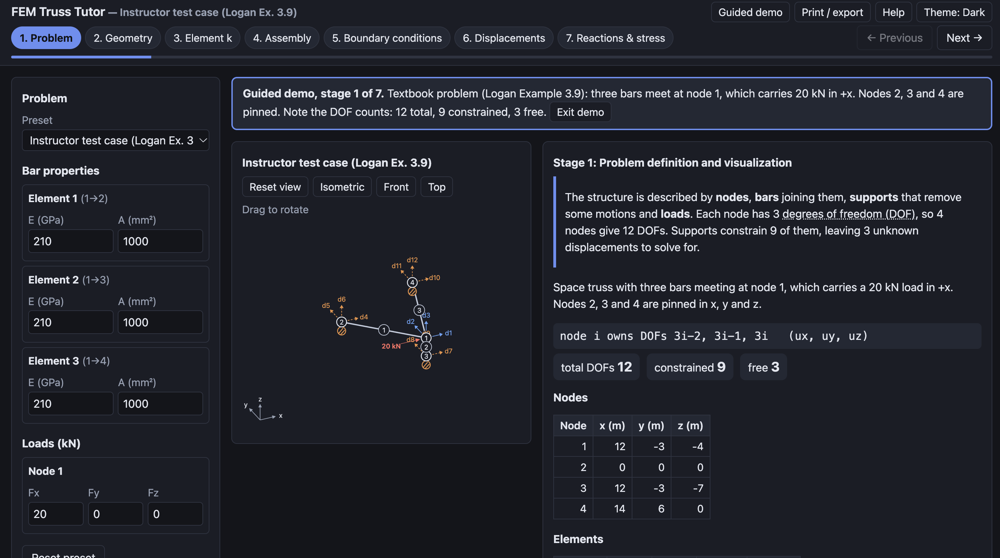
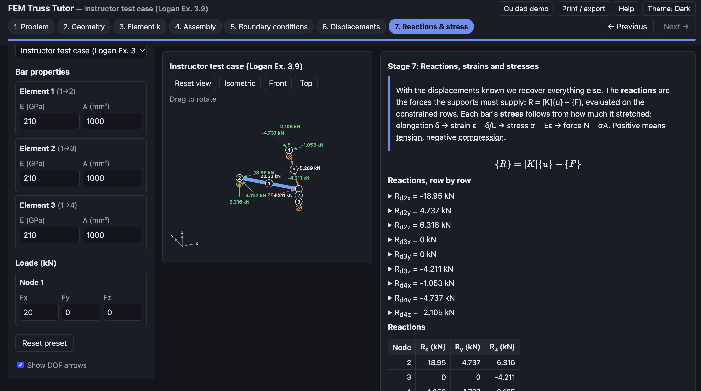

# Demonstration Example

The tool's **Guided demo** button loads the instructor's test case (Logan Example 3.9) and gives a prompt at each stage. Values below are what the tool shows, and match the independent reference solution.

## Part 1: Space truss (Logan Ex. 3.9)
Nodes (m): 1 (12, −3, −4), 2 (0, 0, 0), 3 (12, −3, −7), 4 (14, 6, 0). Bars 1→2, 1→3, 1→4 with E = 210 GPa and A = 1000 mm². Nodes 2, 3, 4 are pinned. Load at node 1: 20 kN in +x.

**Stage 1 – Problem.** 4 nodes × 3 = 12 DOFs; 9 constrained, 3 free (d1x, d1y, d1z).

**Stage 2 – Geometry.**

| Element | L (m) | (Cx, Cy, Cz) | EA/L (MN/m) |
| --- | --- | --- | --- |
| 1 | 13.000 | (−0.9231, 0.2308, 0.3077) | 16.15 |
| 2 | 3.000 | (0, 0, −1) | 70 |
| 3 | 10.050 | (0.1990, 0.8955, 0.3980) | 20.9 |

**Stage 3 – Element stiffness.** k = (EA/L)[λ −λ; −λ λ]. For element 3, [λ] has Cx² = 0.0396, CxCy = 0.1782, Cy² = 0.8020 and so on. The book prints 0.128 for the (2,1) entry; symmetry requires 0.178, which is what the tool shows.

**Stage 4 – Assembly.** Hover K for d1x–d1x: all three bars contribute.

**Stage 5 – Boundary conditions.** The reduced 3 × 3 system (kN/m):

| | d1x | d1y | d1z |
| --- | --- | --- | --- |
| d1x | 14 591.8 | 282.9 | −2 933.0 |
| d1y | 282.9 | 17 618.3 | 8 595.0 |
| d1z | −2 933.0 | 8 595.0 | 74 839.6 |

with F = (20, 0, 0) kN.

**Stage 6 – Displacements.** d1x = 1.3837 × 10⁻³ m, d1y = −5.157 × 10⁻⁵ m, d1z = 6.015 × 10⁻⁵ m. The book gets d1y = −5.119 × 10⁻⁵ m because it rounds the direction-cosine products to 3 decimals; the "Compare with textbook" panel lists both.

**Stage 7 – Reactions and stress.**

| Quantity | Value |
| --- | --- |
| σ₁ | +20.526 MPa (tension) |
| σ₂ | +4.2105 MPa (tension) |
| σ₃ | −5.2894 MPa (compression) |
| Reactions, node 2 (kN) | (−18.947, +4.737, +6.316) |
| Reactions, node 3 (kN) | (0, 0, −4.211) |
| Reactions, node 4 (kN) | (−1.053, −4.737, −2.105) |

Equilibrium: ΣFx = 20 − 20 = 0, ΣFy = ΣFz = 0.

## Part 2: 2D walkthrough (three-bar triangle)
Nodes (m): 1 (0, 0), 2 (4, 0), 3 (2, 3). Bars 1→2, 2→3, 1→3, E = 200 GPa, A = 1000 mm². Pin at node 1, roller at node 2. Load at node 3: 10 kN in +x, 20 kN down. Choose the **2D three-bar triangular truss** preset.

- **Geometry:** L = 4.000, 3.606, 3.606 m; θ = 0°, 123.69°, 56.31°. EA/L = 50, 55.47, 55.47 MN/m.
- **Assembly:** K₅₅ = 17.07 (e2) + 17.07 (e3) = 34.14 MN/m.
- **Reduced system** over (u2x, u3x, u3y), MN/m, with F = (0, 10, −20) kN:

| | | |
| --- | --- | --- |
| 67.0677 | −17.0677 | 25.6015 |
| −17.0677 | 34.1354 | 0 |
| 25.6015 | 0 | 76.8046 |

- **Displacements:** u2x = 0.2333 mm, u3x = 0.4096 mm, u3y = −0.3382 mm.
- **Reactions:** R1x = −10.000 kN, R1y = +2.500 kN, R2y = +17.500 kN.
- **Stresses:** element 1 +11.667 MPa (tension); element 2 −21.032 MPa and element 3 −3.0046 MPa (compression).

