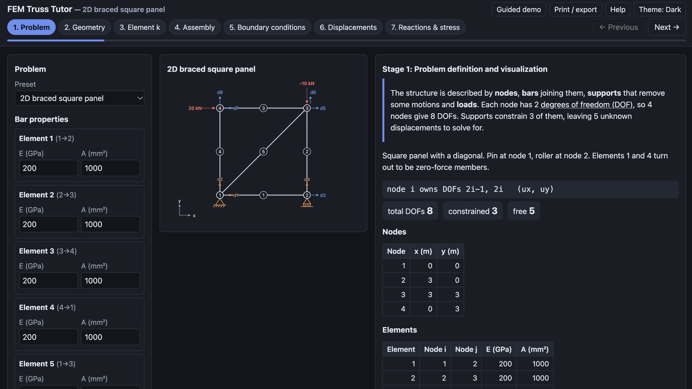
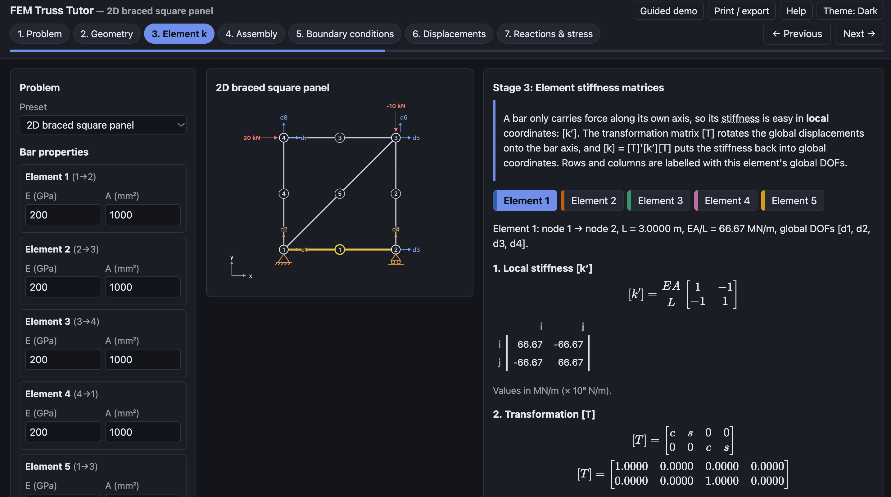
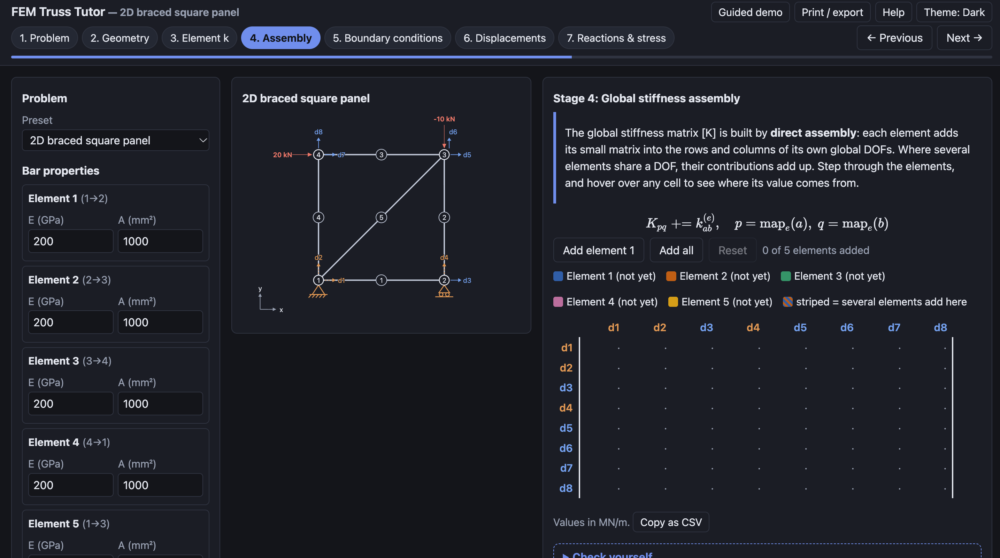
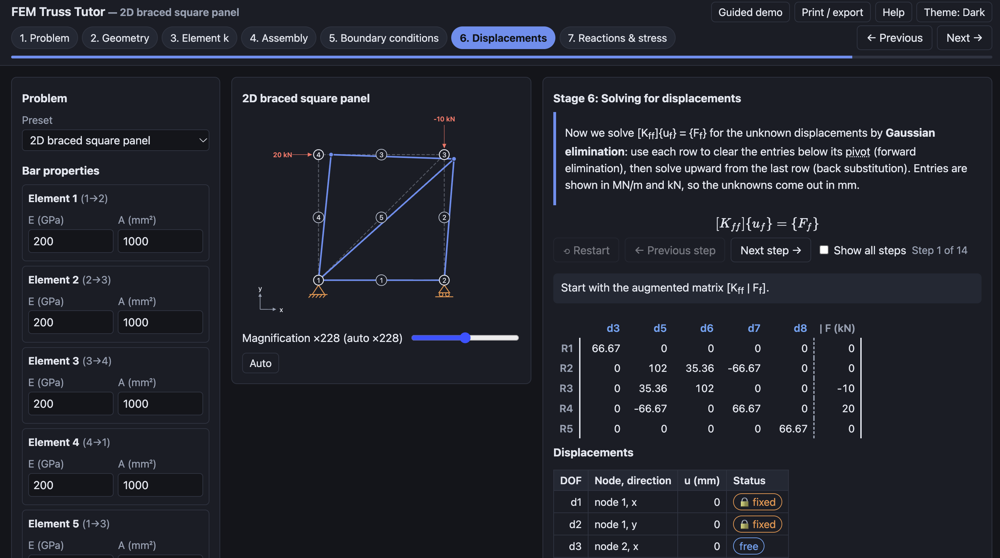
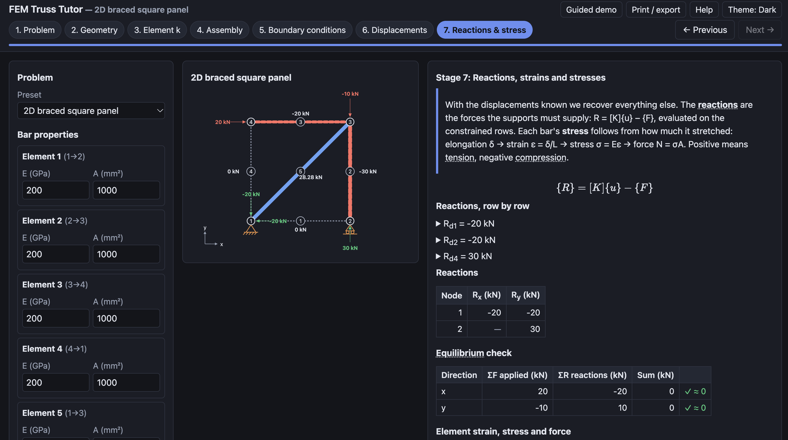

# User Guide

## Open the tool
Double-click `index.html`, or open the hosted link. The tool opens on the instructor's test case (Logan Example 3.9). Equations need an internet connection on first load; without it they show as plain text.

## Choose a problem
Use **Preset** in the left sidebar. There are five: Logan Ex. 3.9 (3D), a 2D triangle, a 2D braced panel, a 3D tripod, and a 3D pyramid. Geometry and supports are fixed for each preset.

## Edit inputs
In the sidebar you can change each bar's **E** (1–1000 GPa) and **A** (1–100 000 mm²) and each load component (kN, any sign). Values are checked when you leave the field; an invalid value shows a red message and the last valid value stays in use. Every valid edit re-solves the problem immediately. **Reset preset** restores the defaults.

## Move between stages
Use the numbered stepper at the top, the **Previous / Next** buttons, or the ← → keys. The current stage appears in the URL (for example `#stage-4`), so you can bookmark or share it.

## The seven stages
1. **Problem** – diagram with node, element and DOF numbers, supports and loads; tables of coordinates, connectivity, supports, loads and DOFs.
2. **Geometry** – length, angle and direction cosines of each bar. Click a row to see the bar's local x′ axis.
3. **Element k** – pick an element tab to see [k′], [T], the product [T]ᵀ[k′][T] and the global [k]. Toggle the symbolic form.
4. **Assembly** – add elements one by one into [K]; cells are colour-coded by element and striped where several elements add. Hover a cell to see its sum.
5. **Boundary conditions** – constraints with reasons, and the reduced system [Kff]{uf} = {Ff}. Press the button to eliminate the rows and columns.
6. **Displacements** – step through Gaussian elimination and back substitution; see the displacement table and the deformed shape (adjust the magnification slider).
7. **Reactions & stress** – reactions row by row, equilibrium check, strain/stress/force per bar with Tension/Compression/Zero badges, and a summary card.

   

## Reading the matrices
Rows and columns are labelled with global DOF numbers (d1, d2, …; d1x, d1y, … for the textbook problem). Blue labels are free DOFs, orange are constrained. Stiffness values are in MN/m. **Copy as CSV** under a matrix copies it for Excel or MATLAB.

## 3D view
Drag the diagram to rotate. **Reset view**, **Isometric**, **Front** and **Top** jump to standard views.

## Other features
- **Check yourself** at the bottom of each stage: answer, then reveal.
- **Help** explains the method. **Guided demo** loads the textbook problem with a prompt for each stage.
- **Print / export** opens the print dialog with a clean solution of all stages (choose "Save as PDF" to export).
- **Theme** cycles Auto, Light and Dark.
- Hover a bar, table row or matrix cell and related items highlight everywhere. Underlined terms have glossary tooltips (also on keyboard focus).

## If something looks wrong
A red **Singular system** banner means the supports do not hold the structure (a mechanism); Stages 6 and 7 then show no results rather than meaningless numbers.
